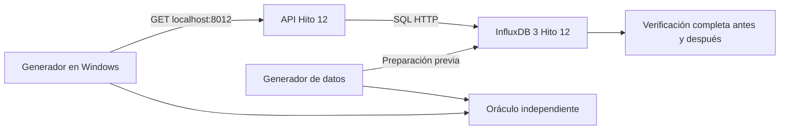

# Flujo y escenario de carga

## Caso operacional

Un espectador consulta estadísticas de un partido finalizado en el Fixture 2030. El cliente envía el identificador y una ventana temporal; la API valida y consulta `estadisticas_equipo` de InfluxDB 3 mediante SQL. Responde posesión media, pases acumulados, tiros y recuperaciones por equipo, sede y ventana. Consumidor: vista postpartido. Flujo: 100% lectura durante la medición.

Endpoint: `GET /api/v1/partidos/{partido_id}/estadisticas`. Parámetros: `desde`, `hasta`, `resolucion`; filtro `equipo` opcional no utilizado en la carga principal. Ventana positiva de hasta 24 horas; identificadores validados. Éxito: HTTP 200, identidad del laboratorio, metadatos correctos, sin truncado y todas las filas iguales al oráculo independiente. No basta un status 200. Registrar HTTP no exitoso, timeout, fallo de red, integridad, atraso del generador y falta de cupo.

## Datos y distribución

`config/dataset.json` fija semilla 1209, 24 partidos, dos equipos sintéticos por partido, seis sedes sintéticas, 90 minutos, un punto cada 5 segundos por equipo: **51.840 registros previstos y generados localmente**. Su carga en InfluxDB todavía no está ejecutada. Todos los partidos usan `[2030-06-08T19:00:00Z, 2030-06-08T20:30:00Z)`; son fechas sintéticas, no fechas de ejecución.

La posesión de ambos equipos suma 100 en cada instante; los pases son acumulados monótonos; tiros y recuperaciones son incrementos. Son distribuciones simplificadas para probar semántica, no un modelo validado de partidos reales. No hay usuarios ni datos personales.

El 80% de las selecciones se concentra en P001–P004 y el 20% en los otros 20 partidos. Es una probabilidad: la proporción observada debe obtenerse de `plan.json`. Las resoluciones `1m`, `5m`, `15m`, `1h` se eligen uniformemente con la misma semilla. Se conserva la lista exacta de solicitudes en todas las repeticiones; la ejecución efectiva puede diferir por errores/cupo y se registra.

## Carga local objetivo

| Fase | Duración configurada | Llegadas |
|---|---:|---|
| Calentamiento | 5 s | 8/s |
| Rampa | 10 s | Crecimiento lineal de 0 a 8/s |
| Sostenimiento | 30 s | 8/s |
| Descanso entre repeticiones | 5 s | Sin carga de usuario |

Concurrencia máxima: 4. Repeticiones: 3 por variante. Timeout del generador: 5 s; dependencia API: 4 s. Sin reintentos automáticos. La agenda nominal contiene 319 operaciones por repetición (40 calentamiento, 39 rampa, 240 sostenimiento); no son operaciones ya ejecutadas.

Se usa un modelo de llegadas programadas, sin cola ilimitada. Si no hay cupo, se registra `capacity`; si la agenda se atrasa más de un intervalo o 200 ms, se registra `generator_late` y no se dispara una ráfaga para compensarlo. Esas operaciones nunca se cuentan como exitosas. El generador puede limitar el ensayo: las métricas del cliente y solicitudes no enviadas permiten detectarlo.

## Interrupción

Se cancela ante cualquier respuesta distinta del oráculo, más de 5% de errores luego de 20 solicitudes completadas, menos de 1.536 MiB disponibles, CPU del host ≥95% en tres muestras consecutivas, memoria de un contenedor ≥90% de su límite, fallo de monitoreo o Ctrl+C. El monitor toma muestras separadas por una espera de 2 s más el costo de `docker stats`; no garantiza detectar un pico instantáneo. Docker impone los límites duros.

Al cancelar se deja de emitir carga, se drenan las solicitudes ya iniciadas bajo sus timeouts y se conserva la evidencia. No se atribuye validez comparativa a una ejecución interrumpida. Se comprueba integridad y estabilidad de contenedores después de cada repetición.

## Escala proyectada: supuesto, no medición

Como ejemplo analítico, **si** se consideran 104 partidos, dos equipos, 90 minutos y muestreo de 1 s, resultarían 1.123.200 puntos. La cifra es una proyección aritmética propuesta, no una exigencia confirmada del TPO ni capacidad demostrada. Reemplazar el supuesto cuando el equipo aporte su dimensionamiento. Una notebook a 8 llegadas/s no permite extrapolar linealmente latencia, throughput, memoria o concurrencia productiva.
